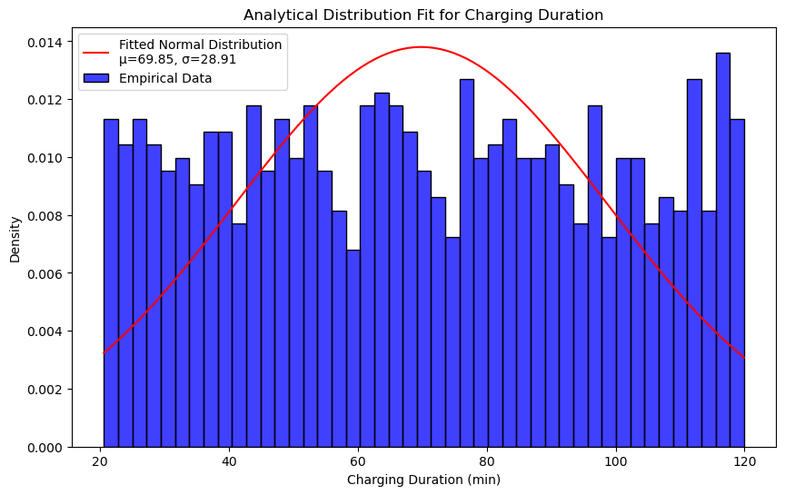
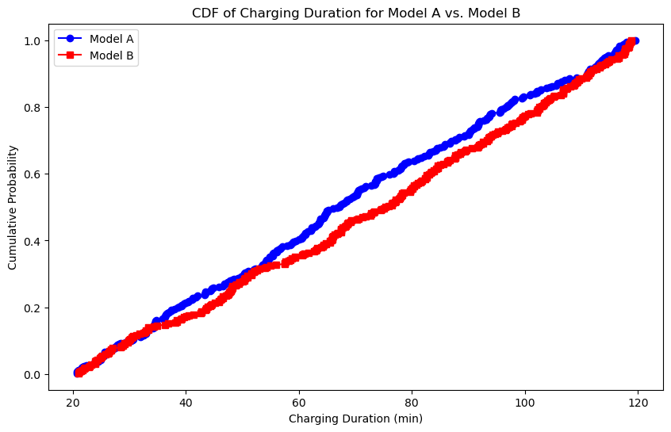

# Electric Vehicle Charging: Exploratory Data Analysis

**What drives how long an EV takes to charge?** This project explores a dataset of 1,000 EV charging sessions to find which factors, if any, explain charging duration, with the goal of helping prospective buyers understand "charge anxiety."

📓 [View the notebook](ev_charging_eda.ipynb) · 📄 [Read the paper (PDF)](ev_charging_paper.pdf) · 📊 [View the slides (PDF)](ev_charging_presentation.pdf)

---

## Key Findings

- **No single variable meaningfully explains charging duration.** Correlations with charging cycles (r = -0.01) and state of charge (r = -0.06) were essentially zero.
- **Fast vs. slow charging showed no significant difference** in session duration (Mann-Whitney U, p = 0.45).
- **Current (amps) had no predictive power** in a linear regression (R² = 0.00, p = 0.52).
- **Most variables were nearly uniformly distributed** rather than bell-shaped; only degradation rate looked approximately normal. That pattern, combined with near-zero relationships, suggests the dataset may be synthetic or missing key drivers such as **battery capacity**.

*Charging duration is spread almost evenly between 20 and 120 minutes, so a normal distribution (red) fits poorly.*

## Data

- **Source:** [EV Battery Charging Data, Kaggle](https://www.kaggle.com/datasets/ziya07/ev-battery-charging-data)
- **Size:** 1,000 charging sessions, 13 variables
- **Variables analyzed:** state of charge (%), battery temperature, ambient temperature, charging duration (min), degradation rate (%), charging cycles, current (A), charging mode, and EV model

## Approach

1. **Cleaning:** Standardized column names and reviewed ranges for unrealistic values.
2. **Univariate analysis:** Histograms and summary statistics (mean, variance, standard deviation) for six key variables.
3. **Distributions:** Compared Model A vs. Model B using a PMF (charging cycles) and CDF (charging duration); fit an analytical normal distribution to charging duration.
4. **Relationships:** Scatter plots with Pearson correlation for duration vs. charging cycles and duration vs. state of charge.
5. **Hypothesis test:** Shapiro-Wilk confirmed non-normal data, so a Mann-Whitney U test compared fast and slow charging.
6. **Regression:** OLS regression of charging duration on current.

## Lessons Learned & Next Steps

A null result is still a result: this analysis showed that the available variables can't explain charging time on their own. Next steps would be to:

- Bring in **battery capacity**, battery technology, and vehicle make
- Explore what relates to **state of charge** and how **ambient temperature** affects capacity
- Validate findings on a real-world charging dataset

## Tools

Python · pandas · NumPy · matplotlib · seaborn · SciPy · statsmodels · Jupyter

---

*Completed March 2025 as a term project for DSC 530 (Data Exploration and Analysis).*
